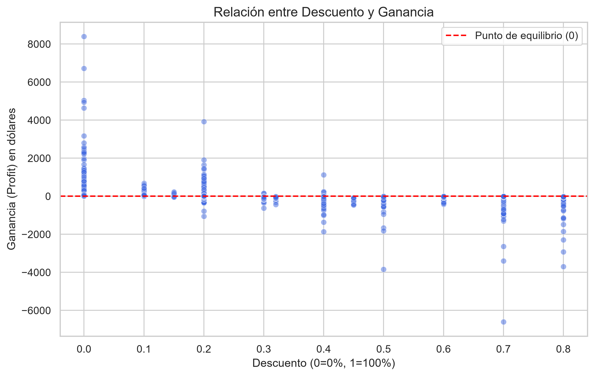

# Análisis de Rentabilidad - Superstore

## 📝 Descripción
Análisis exploratorio de datos (EDA) para identificar por qué las ventas de la tienda no siempre se traducen en ganancias. Se analizaron 9,994 transacciones.

## 🛠️ Herramientas utilizadas
*   **Python** (Pandas para manipulación y limpieza de datos)
*   **Matplotlib** y **Seaborn** (para visualización de datos)
*   **VS Code** y **Git** (control de versiones)

## 🔍 Hallazgos Principales
*   **El problema no es el volumen, es el margen:** Las subcategorías "Tables" y "Bookcases" generan pérdidas millonarias para la empresa.
*   **Causa raíz:** Los descuentos agresivos (superiores al 20%) en estas categorías están destruyendo el margen de ganancia. Por ejemplo, las Mesas tienen un descuento promedio del 26% y una pérdida promedio de -$55 por venta.
*   **El salvavidas del negocio:** Las Fotocopiadoras (Copiers) son el producto estrella. Tienen un descuento menor (16%) y generan una ganancia promedio de +$817 por unidad.

## 📈 Visualizaciones

## 💡 Recomendaciones
1.  **Revisar la política de descuentos:** Limitar los descuentos de Mesas y Estanterías a un máximo del 15% para evitar pérdidas.
2.  **Impulsar el mix de productos:** Promocionar las categorías de Fotocopiadoras y Accesorios para compensar las pérdidas del mobiliario.

## 📂 Estructura del proyecto
*   `data/`: Datos originales (CSV).
*   `notebooks/`: Notebook con el análisis y limpieza de datos.
*   `outputs/`: Gráficos generados (Descuento vs Profit, Rentabilidad por Subcategoría).

## 🚀 Cómo ejecutar este proyecto localmente
1. Clona este repositorio:`https://github.com/DJimenez71/analisis_rentabilidad.git`
2. Instala las dependencias necesarias: `pip install -r requirements.txt`
3. Abre el notebook en Jupyter o VS Code.

## 📂 Fuentes y Datos
Los datos utilizados en este proyecto provienen del dataset [Superstore Dataset](https://www.kaggle.com/datasets/yesshivam007/superstore-dataset) disponible en Kaggle.

## 👩‍💻 Autora
*Análisis realizado por A como parte de mi portafolio de análisis de datos.*
*10 de noviembre de 2026*